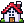
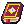
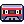
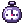
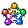

# Schmookey's 16-bit icon collection

An evolving collection of retro pixel-art SVGs used on [schmookey.xyz](https://schmookey.xyz). Each icon is available as a separate, scalable SVG with a transparent background. The original website assets remain in place.

[Open the printable icon sheet](icon-sheet.html) (download and open locally to view in a browser).

## Navigation

| Back | Forward | Home | Archive |
| :---: | :---: | :---: | :---: |
|  |  |  |  |
| [SVG](navigation/back.svg) | [SVG](navigation/forward.svg) | [SVG](navigation/home.svg) | [SVG](navigation/archive.svg) |

## Inventory and status

| Book | Cassette | Coffee | Energy | Game Controller | Sleep | Waypoint |
| :---: | :---: | :---: | :---: | :---: | :---: | :---: |
|  |  |  |  |  |  |  |
| [SVG](inventory/book.svg) | [SVG](inventory/cassette.svg) | [SVG](inventory/coffee.svg) | [SVG](inventory/energy.svg) | [SVG](inventory/game-controller.svg) | [SVG](inventory/sleep.svg) | [SVG](inventory/waypoint.svg) |

## HUD — dark

| Comments | Likes | Shares | Time | Words |
| :---: | :---: | :---: | :---: | :---: |
|  |  |  |  |  |
| [SVG](hud/dark/comments.svg) | [SVG](hud/dark/likes.svg) | [SVG](hud/dark/shares.svg) | [SVG](hud/dark/time.svg) | [SVG](hud/dark/words.svg) |

## HUD — light

| Comments | Likes | Shares | Time | Words |
| :---: | :---: | :---: | :---: | :---: |
|  |  |  |  |  |
| [SVG](hud/light/comments.svg) | [SVG](hud/light/likes.svg) | [SVG](hud/light/shares.svg) | [SVG](hud/light/time.svg) | [SVG](hud/light/words.svg) |

## Social platforms

| Bluesky | Fediverse | Mastodon | GitHub |
| :---: | :---: | :---: | :---: |
|  |  |  |  |
| [SVG](social/bluesky-16bit.svg) | [SVG](social/fediverse-16bit.svg) | [SVG](social/mastodon-16bit.svg) | [SVG](social/github-16bit.svg) |

## Reuse and licensing

Copyright (C) 2026 Schmookey. The original SVG icons in navigation/, inventory/ and hud/ (including both themes), and the corresponding website copies listed in sources.tsv, are licensed under the GNU General Public License, version 3 or (at your option) any later version (SPDX: GPL-3.0-or-later). The social/ icons and their website counterparts are excluded; their respective rights holders' terms and trademark rules apply. No licence is granted here for third-party marks. The website source code remains MIT-licensed.

You may use, modify and redistribute the original icons, including commercially, without paying a licence fee. When distributing covered icons or modifications, comply with GPL conditions, including preserving notices, providing the preferred editable source and licensing covered modifications under the GPL. See [COPYING](COPYING) for the full licence and [LICENCE.md](LICENCE.md) for scope. The social marks are not included in this grant.

## Adding icons

Add new SVGs to the appropriate category, update the sheet and this index, and preserve the original artwork and source path. Keep the live website assets in place. See [sources.tsv](sources.tsv) for the source mapping.
