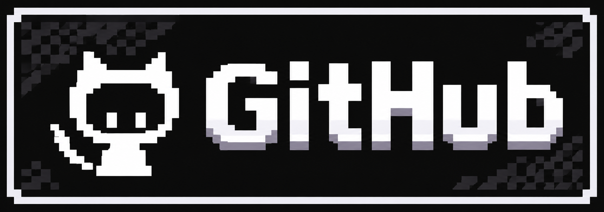
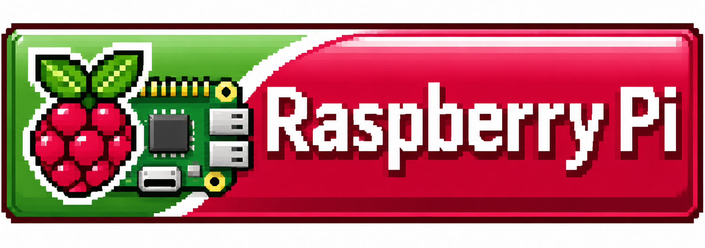

# Schmookey's 88×31 pin collection

An archive of the small web buttons stored with [Schmookey's World](https://schmookey.xyz/), including unused, historical and alternate designs. **34 unique native 88×31 buttons, plus 2 high-resolution badge designs.** 3 additional byte-identical source filenames are recorded rather than duplicating the same preview. The original assets are untouched.

[Open the printable pin sheet](pin-sheet.html) (download the repository and open locally). Click a preview to open the original-size collection copy. GIFs retain their original animation. High-resolution artwork is shown at button size but the linked files remain high-resolution.

## Schmookey's World

| Schmookey — current | Schmookey — earlier button |
| :---: | :---: |
|  |  |
| [GIF](images/schmookey-88x31.gif) | [GIF](images/schmookey.gif) |

## Socials and communities

| Mastodon | Bluesky | Bandcamp | Steam |
| :---: | :---: | :---: | :---: |
|  |  |  |  |
| [GIF](images/mastodon_button_1.gif) | [GIF](images/bluesky.gif) | [PNG](images/bandcamp1.png) | [GIF](images/steam.gif) |

| GOG | ListenBrainz | Fediverse | Neocities |
| :---: | :---: | :---: | :---: |
|  |  |  |  |
| [PNG](images/e-gog.png) | [GIF](images/listenbrainz88x31.gif) | [PNG](images/fediverse.png) | [GIF](images/neocitiesblue.gif) |

| Guestbook |
| :---: |
|  |
| [GIF](images/guestbook-button.gif) |

## IndieWeb and web standards

| IndieWeb | IndieWeb — flat | Webmention | Webmention — flat |
| :---: | :---: | :---: | :---: |
|  |  |  |  |
| [PNG](images/88x31_IndieWeb.png) | [PNG](images/indieweb88x31-flat.png) | [PNG](images/88x31_Webmention.png) | [PNG](images/webmention88x31-flat.png) |

| Microformats | Creative Commons BY-NC | Valid HTML5 | Valid RSS |
| :---: | :---: | :---: | :---: |
|  |  |  |  |
| [PNG](images/88x31_Microformats.png) | [PNG](images/CC_BY-NC_icon-88x31.png) | [GIF](images/valid-html5.gif) | [PNG](images/valid-rss.png) |

| Valid RSS — alternate | Valid Atom | Valid JSON |
| :---: | :---: | :---: |
|  |  |  |
| [PNG](images/valid-rss-rogers.png) | [PNG](images/valid-atom.png) | [PNG](images/valid-json.png) |

## Software, projects and causes

| Internet Archive | Right to Repair | Linux Mint | Firefox |
| :---: | :---: | :---: | :---: |
|  |  |  |  |
| [GIF](images/internet-archive.gif) | [PNG](images/right2repair.png) | [GIF](images/linux_mint.gif) | [GIF](images/getfirefox-button.gif) |

| KeePassXC | VLC | Wikipedia | Home Assistant |
| :---: | :---: | :---: | :---: |
|  |  |  |  |
| [PNG](images/keepassxc.png) | [PNG](images/VLC.png) | [GIF](images/wikipedia2.gif) | [PNG](images/home_assistant_88x31.png) |

## Retro gaming

| Sega Genesis / Mega Drive | Dreamcast | PlayStation | Nintendo Wii |
| :---: | :---: | :---: | :---: |
|  |  |  |  |
| [GIF](images/segagen.gif) | [GIF](images/dreamcast.gif) | [GIF](images/psbutton.gif) | [GIF](images/wii.gif) |

## High-resolution badge artwork

| GitHub | Raspberry Pi |
| :---: | :---: |
|  |  |
| [PNG (original)](images/github_88x31.png) | [PNG (original)](images/raspberry-pi-retro-web-badge.png) |

## Source mapping and maintenance

See [sources.tsv](sources.tsv) for every stored filename, including aliases and the root-level Internet Archive copy. Collection copies are byte-for-byte identical to the original assets at the time of cataloguing. To add a badge, copy the original into `images/`, update this index, the pin sheet and source mapping. This is a repository showcase, not a new live-site page.

## Reuse and licensing

This is a collection of badges, not a blanket licence grant. Many badges are third-party artwork or trademarks. Their respective owners' terms apply; consult [the repository content-licensing notes](../docs/CONTENT-LICENSING.md) before reusing or redistributing them. The MIT website-code licence and the GPL licence for the original 16-bit SVG icon collection do not automatically cover these badges. No claim of authorship or affiliation is made for third-party badges.
